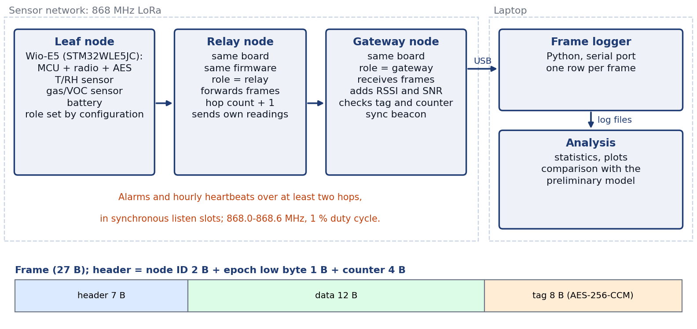

# IoT-Based Early Forest Fire Detection Network

[](https://github.com/beratssert/fire-detection-network/actions/workflows/ci.yml)

A small prototype of a low-power, authenticated, multi-hop LoRa sensor network for early forest-fire detection, built
to **measure** the quantities that earlier analyses of such networks had to assume.

Graduation project, Department of Computer Engineering, Akdeniz University, Antalya, Türkiye.

> This README describes the project itself and changes only if the project changes.
> Current status, milestones and the team workflow are in [`management/`](management/).

## Summary

Early detection of forest fires in Türkiye relies largely on lookout towers, cameras and satellites. These methods
notice a fire only once smoke or heat becomes visible from a distance. Low-cost sensor nodes placed on tree trunks and
on the ground could capture the first minutes; however, the number of nodes needed, their energy consumption and the
cost of securing their alarms have not been measured for the forests of Türkiye.

Our team's preliminary analyses for Calabrian pine (*Pinus brutia*) forests indicate that node density is set by the
sensing range, not by the radio range. However, key inputs of these analyses rest on assumptions: the gas and heat
sensing range, the radio path loss under the canopy, the clock drift between nodes and the node current.

This project builds a small prototype of 3–5 sensor nodes and one gateway to measure these quantities. In the
prototype, alarms are relayed over at least two hops, and every frame is sent with authenticated AES-CCM encryption and
replay protection. The method develops a single link first, then the multi-hop network, and finally the security
layer. Link quality, packet delivery ratio, per-hop delay, clock drift, current consumption and the overhead of security
are measured first on campus and in the laboratory, and in a forest area if permission is granted. The response of the
gas sensor is tested only with a small, safe and controlled source.

Each measurement is compared with the corresponding assumption of the preliminary analyses; node-density and
battery-life estimates are recalculated with the measured values, and the assumptions that are not confirmed are
reported. The measured values will give forest administrations and network designers estimates of node count, battery
life and alarm delay that rest on measurement rather than on vendor claims.

## Research question

When the key performance parameters of a low-power, authenticated, multi-hop sensor network prototype — link loss,
packet delivery ratio, per-hop delay, clock drift, current consumption, security overhead and gas sensor response —
are measured on real hardware, how far do they agree with the values assumed in the preliminary analyses, and how does
the difference change the estimates of node density and battery life?

Hypotheses:

1. The path-loss exponent under tree cover is clearly higher than in open terrain.
2. The clock drift is large enough to require a guard time in synchronous listen slots.
3. An 8-byte authentication tag increases the airtime of an alarm frame from about 51.5 ms to 66.8 ms, but the duty-cycle
   limit is still respected.

Details: [docs/project.md](docs/project.md).

## Objectives

1. Build a prototype network of 3–5 sensor nodes and 1 gateway with long-range, low-power 868 MHz radios and
   temperature/humidity and gas sensors.
2. Implement a synchronous relay protocol that carries alarms and hourly heartbeats to the gateway over at least two
   hops, within the 1 % duty-cycle limit of the 868.0–868.6 MHz band.
3. Implement a security layer: per-node derived keys, AES-256-CCM with an 8-byte authentication tag, and a replay
   window at the gateway.
4. Measure radio path loss and packet delivery at ≥ 5 distances, ≥ 100 frames per point, two data-rate settings and two
   placements (trunk-mounted at 2.5 m and ground level).
5. Measure the per-hop delay distribution from ≥ 200 alarms and the clock drift between node pairs (ppm).
6. Measure the node current in each operating state and compute the battery life of a heat-only leaf node.
7. Record the gas sensor response (response time and signal change) to a small, safe and controlled source.
8. Compare every measured quantity with the assumed value of the preliminary analyses, recalculate the node-density and
   battery-life estimates, and report which assumptions were not confirmed.

The project is judged by honest and complete reporting of the measurements.
Success criteria for each objective: [docs/project.md](docs/project.md#aim-and-objectives).

## System overview



- All nodes run the same firmware; the role (leaf node, relay, gateway) is set by configuration.
- Alarms and hourly heartbeats reach the gateway over at least two hops, using synchronous listen slots in which nodes
  listen periodically for a short time.
- Each node operates in the 868.0–868.6 MHz band within the 25 mW e.r.p. limit of this band (about 14 dBm transmitter
  output, taking the antenna gain into account) and transmits at most 36 s in any one-hour observation window
  (1 % duty cycle).
- Every frame consists of a 7-byte header (node ID, epoch byte, counter), 12 bytes of data and an 8-byte authentication
  tag. Node keys are derived from a master key with the node ID; frames are protected with AES-256 in CCM mode; the
  nonce is built from the counter, the epoch and the node ID. The gateway applies a counter window against replay, and
  the epoch is written to non-volatile memory at every start-up.
- The gateway is connected to a laptop over USB; for every received frame the time stamp, source, hop count, RSSI, SNR
  and authentication result are written to a file.

More: [architecture](docs/architecture.md), [frame format](docs/frame-format.md), [data model](docs/data-model.md),
[method](docs/method.md).

## Hardware

| Part | Used for |
|---|---|
| Seeed Wio-E5 mini development board (STM32WLE5JC: microcontroller, 868 MHz LoRa radio and hardware AES unit on one chip) | every node and the gateway |
| ST-LINK/V2 programmer/debugger (SWD) | flashing and debugging the boards |
| Temperature/humidity sensor | heat channel of the sensor node |
| Gas/VOC sensor (the preliminary model assumes a Bosch BME688) | gas channel of the sensor node |
| Power profiler (fallback: shunt resistor and oscilloscope) | current measurements in each operating state |
| Laptop | gateway host, frame logging, analysis |

## Work packages

| WP | Content |
|---|---|
| WP1 | Single link and logging infrastructure; first airtime and current measurements |
| WP2 | Multi-hop network, clock drift and guard window |
| WP3 | Security layer and tests with forged frames |
| WP4 | Measurement campaigns: path loss, delay, energy, gas sensor response |
| WP5 | Comparison of the measurements with the preliminary analyses; recalculation of the estimates |

WP1–WP3 serve objectives 1–3, WP4 serves objectives 4–7, WP5 serves objective 8.
Full definitions: [docs/work-plan.md](docs/work-plan.md).

## Measurements and safety

Measurements are made on a green area of the campus and in the laboratory first (stage A) and, if permission is
granted, in a *Pinus brutia* stand (stage B). Stage A is sufficient to complete the project; if stage B is not
possible, the forest-specific values remain marked as assumptions. Smoke and gas response is tested only with a very
small, safe and controlled source, outdoors or in a ventilated room; the method and the safety rules are approved with
the supervisor and under the department's laboratory rules. **No real fire experiment is carried out.**

## Outputs

- A working prototype network (3–5 sensor nodes and 1 gateway).
- Open-source node and gateway software and the frame logging tool.
- Raw measurement data, field notes and analysis code.
- A report comparing measurements with assumptions, and a project final report.
- At least one paper with the measurement data and the comparison, submitted to a national or international
  peer-reviewed journal or conference.

No commercial product, patent or utility model is planned.

## Repository layout

| Path | Content |
|---|---|
| [`firmware/`](firmware/) | node, relay and gateway firmware (STM32WLE5JC) |
| [`gateway-logger/`](gateway-logger/) | laptop-side frame logger (Python) |
| [`analysis/`](analysis/) | measurement analysis and comparison with the preliminary model |
| [`data/`](data/) | raw measurement data, one folder per test run |
| [`poster/`](poster/) | archive of the preliminary analyses (frozen): model code, results and the poster ([how the results are computed](poster/METHOD.md)) |
| [`docs/`](docs/) | project description, method, work plan, architecture, design decisions, interface contracts (frame format, serial protocol, data model) |
| [`management/`](management/) | status, milestones, team workflow (changes as the project moves on) |

## Getting started

```bash
git clone https://github.com/beratssert/fire-detection-network.git
cd fire-detection-network
bash scripts/setup.sh   # once per clone, in Git Bash on Windows (see management/WORKFLOW.md#local-set-up)
```

- Keys and secrets: read [`docs/key-management.md`](docs/key-management.md) before working with keys.
- AI coding agents: rules in [`AGENTS.md`](AGENTS.md).
- Security issues: see [`SECURITY.md`](SECURITY.md).
- Firmware: STM32CubeIDE with the STM32CubeWL package; flashing over the ST-LINK/V2. See [`firmware/`](firmware/).
- Preliminary model and poster: see [`poster/README.md`](poster/README.md).

## Team

Hanifi Berat Sert, Halit Dündar, Ali Fuat Akyemiş, Yusuf Şamil Üzüm — all members share responsibility equally.
Supervisor: Asst. Prof. Dr. Murat Ak.

## License

- Code: [MIT License](LICENSE).
- Data, results, figures, the poster and the documentation:
  [Creative Commons Attribution 4.0 International (CC BY 4.0)](LICENSE-CC-BY-4.0.txt).

Anyone may use, change and share both the code and the results, provided they credit this project.

Exception: [`poster/posternat.bst`](poster/posternat.bst) is a modified copy of `unsrtnat.bst` by Patrick W. Daly and
is distributed under the [LaTeX Project Public License](https://www.latex-project.org/lppl/), as stated in the file.
