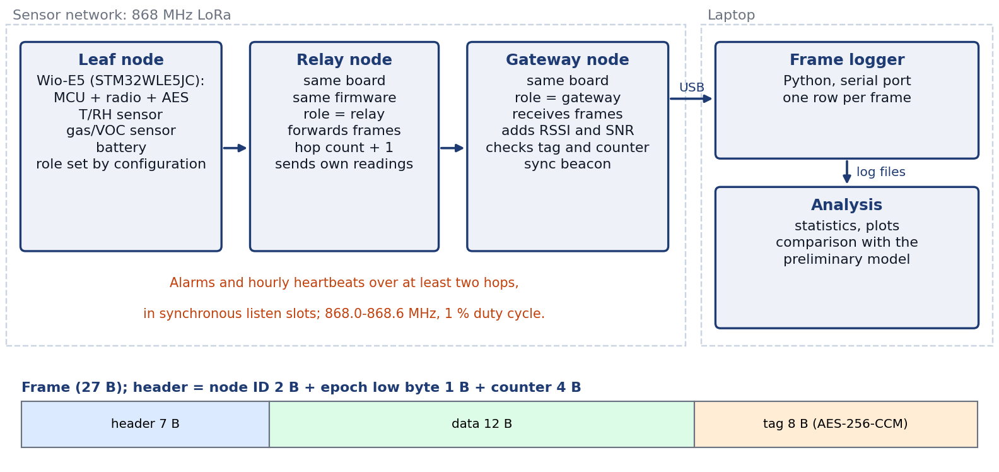

# Architecture

The figure is generated by [`img/make_figures.py`](img/make_figures.py).

## Components

| Component | Responsibility | Interfaces |
|---|---|---|
| Node firmware, leaf role | Sample the sensors, build frames, send alarms and hourly heartbeats, sleep between listen slots. | STM32WLE5 sub-GHz radio; I²C sensors; configuration block (node ID, role, key). |
| Node firmware, relay role | Same firmware; additionally receive frames from neighbours in the listen slots and forward them towards the gateway (hop count + 1). | LoRa, 868.0–868.6 MHz. |
| Gateway firmware | Receive frames, add RSSI and SNR, check the authentication tag and the counter window, send one line per frame to the laptop; send the synchronisation beacon. | Same board; USB serial (virtual COM port) to the logger. |
| Frame logger (laptop) | Read the serial port, add the laptop time stamp, decode the frame and write one row per frame together with the run metadata. | Files in [`data/`](../data/), see [data-model.md](data-model.md). |
| Analysis (laptop) | Statistics of each test run and comparison with the preliminary model. | Reads [`data/`](../data/); in WP5, a copy of the preliminary model from [`poster/`](../poster/). |

## Communication

- All nodes run the same firmware; the role (leaf node, relay, gateway) is set by configuration.
- Alarms and hourly heartbeats reach the gateway over at least two hops. Nodes listen periodically for a short time
  (synchronous listen slots, 2–30 s in the preliminary model); the guard window around each slot is set from the
  measured clock drift (WP2).
- Radio: 868.0–868.6 MHz band, at most 25 mW e.r.p. (about 14 dBm transmitter output), at most 36 s of transmission
  in any one-hour window (1 % duty cycle).
- The expected per-hop delay is a uniform wait over the listen slot plus the airtime of the frame.

## Security

Every frame carries an 8-byte AES-256-CCM authentication tag. Node keys are derived from a master key with the node ID;
the master key does not leave the laptop. See [frame-format.md](frame-format.md).
