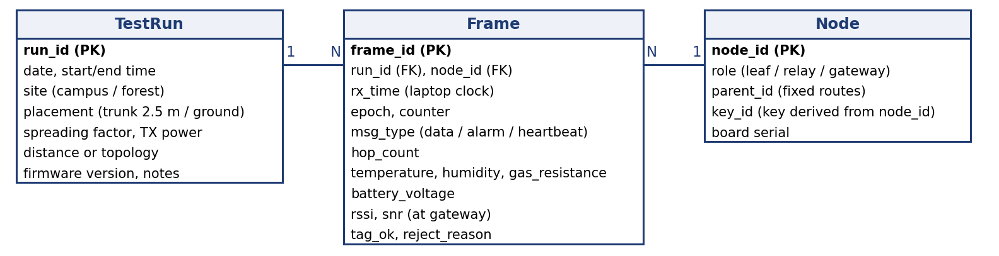

# Data model

The figure is generated by [`img/make_figures.py`](img/make_figures.py).

| Entity | Content | Stored in |
|---|---|---|
| TestRun | one experiment: date, start/end time, site (campus / forest), placement (trunk 2.5 m / ground), spreading factor and transmit power, distance or topology, firmware version, notes | `data/runs/<run_id>/run.json` |
| Node | one board: node ID, role, parent (fixed routes), key ID, board serial | `data/nodes.csv` |
| Frame | one row per frame received by the gateway | `data/runs/<run_id>/frames.csv` |

`frames.csv` columns: `frame_id, run_id, node_id, rx_time, epoch, counter, msg_type, hop_count, temperature, humidity,
gas_resistance, battery_voltage, rssi, snr, tag_ok, reject_reason`.

**Run ID:** `<UTC start>_<site>_<number>`, for example `20261205T1430Z_campus_01`. `<UTC start>` is written as
`YYYYMMDDTHHMMZ`, `<site>` is `lab`, `campus` or `forest`, and `<number>` has two digits. Only letters, digits and `_`
are used, because the ID is a folder name and characters such as `:` are not allowed on Windows.

**Open:** the types and units of the `frames.csv` columns and the `run.json` fields are open decision D11 in
[decisions.md](decisions.md); they are filled in here by the pull request that decides them.

A test run has many frames; a node has many frames. Raw files are never edited: corrections are made in the analysis
code. In WP5 the preliminary model is copied from the frozen archive [`poster/`](../poster/) to
[`analysis/`](../analysis/); each measured value is entered into the parameter file of that copy together with the run
that produced it, next to the assumed value it replaces.
